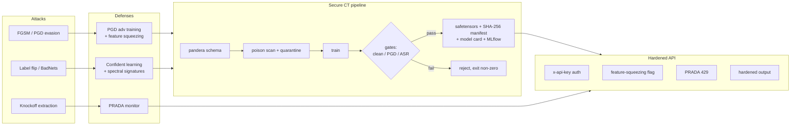
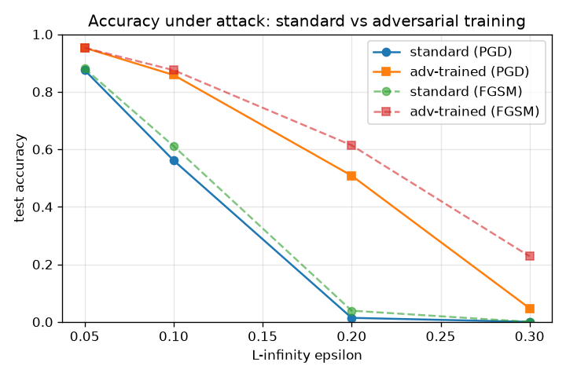
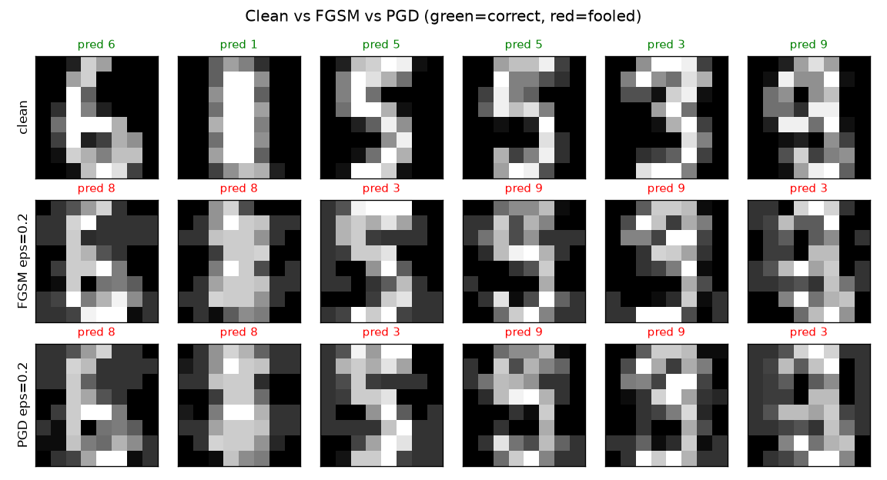
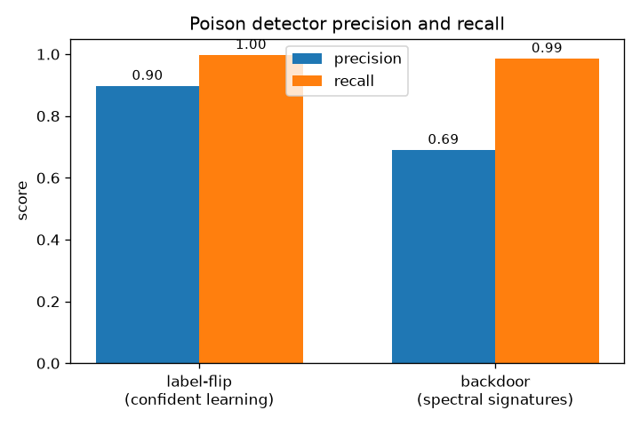
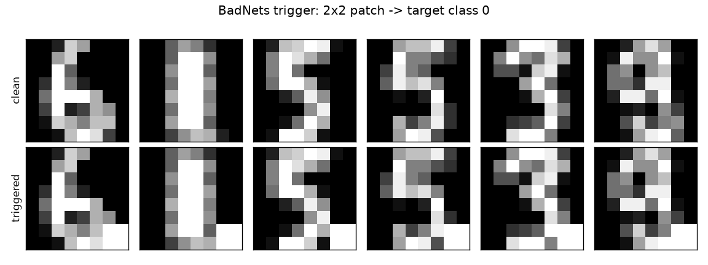
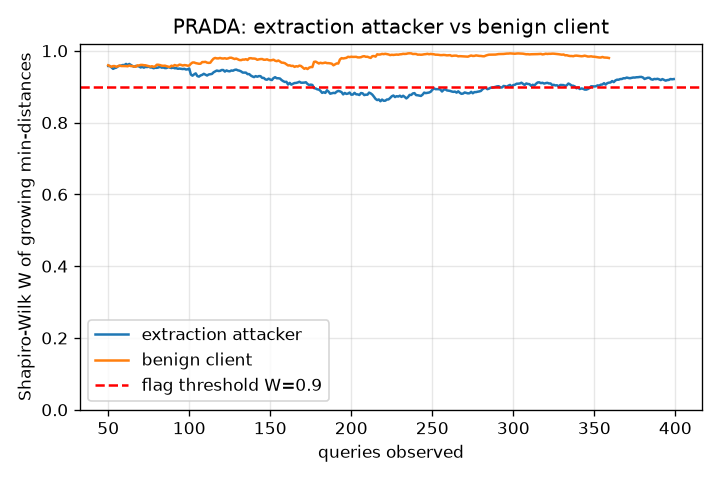

# Aegis-ML: Adversarial ML Defense Lab

Attacks, defenses, and a secure continuous-training pipeline for an image
classifier, measured end to end with real numbers.

[](https://github.com/kamalesansam/aegis-ml/actions/workflows/ci.yml)


## What it is

Aegis-ML takes a small CNN trained on the scikit-learn digits dataset and runs
the full adversarial-ML lifecycle against it: evasion, data poisoning, backdoors,
and model extraction, each paired with a named defense from the literature. The
centerpiece is a continuous-training pipeline that validates an incoming data
batch, scans it for poison, quarantines what it finds, retrains, and promotes the
model only if it clears clean-accuracy, PGD-accuracy, and backdoor-ASR gates. A
hardened FastAPI server then serves the verified model with authentication, input
and output hardening, and live extraction monitoring.

Every number in this README comes from [`reports/results.json`](reports/results.json),
produced by `make report`.

Companion project: [FraudGuard](https://github.com/kamalesansam/fraudguard)
covers the other half of DevSecMLOps, the hardened supply chain that ships a
model (data contracts, DVC, signed images, SBOMs, DAST, drift monitoring).

## Architecture



## Results

Dataset: `sklearn.load_digits`, 8x8 grayscale, 10 classes. Seeded stratified
split: 1167 train / 270 val / 360 test. Seed 1337.

Baseline clean test accuracy: **0.983** (standard), **0.964** (adversarial
training).

### Evasion and adversarial training

Test accuracy under L-infinity attack. The standard model collapses; the
adversarially trained model keeps much of its accuracy.

| attack | model | eps 0.05 | eps 0.1 | eps 0.2 | eps 0.3 |
| --- | --- | --- | --- | --- | --- |
| PGD | standard | 0.875 | 0.561 | 0.014 | 0.000 |
| PGD | adv-trained | 0.953 | 0.858 | 0.508 | 0.047 |
| FGSM | standard | 0.881 | 0.611 | 0.039 | 0.000 |
| FGSM | adv-trained | 0.953 | 0.875 | 0.614 | 0.228 |





### Feature squeezing (adversarial input detection)

At eps 0.2, the detector threshold is calibrated to a 5% target false-positive
rate on clean validation data.

| metric | value |
| --- | --- |
| clean false-positive rate | 0.067 |
| FGSM detection rate | 0.519 |
| PGD detection rate | 0.472 |

### Data poisoning

| attack | effect | detector precision | detector recall | after cleanup |
| --- | --- | --- | --- | --- |
| Label flip (30%) | accuracy 0.972 -> 0.950 | 0.897 | 0.997 | accuracy 0.958 |
| BadNets backdoor (6%) | ASR 0.985 | 0.690 | 0.986 | ASR 0.015 |

The backdoor reaches a 98.5% attack success rate undetected. The spectral
signatures scan catches 98.6% of the injected samples; after quarantine and
retraining the attack success rate drops to 1.5%.





### Model extraction

A Knockoff-style attacker with query-only access trains a surrogate. Fidelity is
agreement with the victim on the test set.

| query budget | surrogate accuracy | fidelity |
| --- | --- | --- |
| 250 | 0.831 | 0.836 |
| 500 | 0.900 | 0.911 |
| 1000 | 0.928 | 0.931 |
| 2000 | 0.958 | 0.975 |

PRADA flags the extraction client after **176 queries** and does not flag a
benign client streaming real test images.



## Attacks and defenses

| Attack | Paper | Defense | Paper | Where in code |
| --- | --- | --- | --- | --- |
| FGSM / PGD evasion | Goodfellow 2014, Madry 2017 | PGD adversarial training; feature squeezing | Madry 2017, Xu 2018 | `attacks/evasion.py`, `defenses/adversarial_training.py`, `defenses/input_detection.py` |
| Label flipping | - | Confident-learning label-noise detection | Northcutt 2021 | `attacks/poisoning.py`, `defenses/poison_detection.py` |
| BadNets backdoor | Gu 2017 | Spectral signatures | Tran 2018 | `attacks/poisoning.py`, `defenses/poison_detection.py` |
| Model extraction | Orekondy 2018 | PRADA query monitor; output hardening | Juuti 2019 | `attacks/extraction.py`, `defenses/extraction_detection.py`, `api/app.py` |

## Secure continuous-training pipeline

`aegis pipeline run --scenario {clean,label_flip,backdoor}` runs the gated flow
in [`src/aegis/pipeline/secure_retrain.py`](src/aegis/pipeline/secure_retrain.py):

1. **Schema validation** (pandera): 64 features in [0,1], integer labels 0..9, no
   NaNs, no duplicate rows. A bad batch is rejected before any training.
2. **Poison scan**: confident-learning label-noise detection plus spectral
   signatures. Flagged samples are written to `quarantine/` with a JSON report.
3. **Train**: standard or PGD adversarial training on the kept samples.
4. **Gates** (from `params.yaml`): clean accuracy >= 0.92, PGD accuracy >= 0.30,
   backdoor ASR <= 0.15. On pass, the pipeline writes safetensors weights, a
   SHA-256 manifest, and a generated model card, and logs to MLflow. On failure
   it prints the failing gate and exits non-zero.

The backdoor scenario shows the gate working both ways:

```
# scan on: poison quarantined, gates pass
$ aegis pipeline run --scenario backdoor
[pipeline] scan flagged 140 (label-noise 44, spectral 100); caught 67/70 known poison
[pipeline] gates: clean=0.961 pgd_robust=0.428 asr=0.012
[pipeline] PASSED.

# scan off: backdoor survives, ASR gate fails, exit 1
$ aegis pipeline run --scenario backdoor --no-scan
[pipeline] gates: clean=0.961 pgd_robust=0.453 asr=1.000
PIPELINE REJECTED: backdoor_asr 1.000 > 0.15
```

## Security engineering

- **safetensors over pickle.** Weights are stored and loaded with safetensors,
  never pickle or `torch.load`. Pickle deserialization runs arbitrary code
  (CWE-502); safetensors has no code path. See `src/aegis/artifacts.py`.
- **Integrity manifests.** Every model ships a JSON manifest with the SHA-256 of
  the weights file, params, metrics, and a data fingerprint. `load_verified`
  recomputes the hash and raises `IntegrityError` on any mismatch.
- **SHA-pinned Actions.** Every GitHub Action is pinned to a full commit SHA with
  the version in a trailing comment. This defends against tag-hijack supply-chain
  attacks (for example CVE-2026-33634, the trivy-action tag hijack).
- **Least-privilege CI.** The workflow sets `permissions: contents: read` at the
  top and escalates to `security-events: write` only in the jobs that upload
  SARIF. Checkout uses `persist-credentials: false`.
- **SAST, SCA, secrets, container.** Bandit and Semgrep (`p/python` plus
  custom ML supply-chain rules in [`.semgrep/`](.semgrep/) that flag
  `torch.load` without `weights_only=True`, pickle/joblib loads and unsafe
  YAML), all as SARIF in GitHub code scanning. pip-audit runs on the
  hash-pinned lockfile export, Gitleaks (checksum-verified binary) scans the full
  git history, and Trivy gates the built image on fixable CRITICAL/HIGH CVEs.
- **Hardened API.** API-key auth with `secrets.compare_digest` and keys from the
  environment, strict pydantic input validation, output limited to the top-1
  label and a 2-decimal confidence, per-key rate limiting, and a PRADA monitor
  that returns 429 on extraction patterns.
- **Hardened container.** Base images pinned by digest, multi-stage build,
  pip/setuptools/wheel removed from the runtime image, UID 10001, model files
  root-owned and read-only. CI runs it with `--read-only --cap-drop ALL
  --security-opt no-new-privileges` and smoke-tests auth before anything else.
  The model is trained at build time, so no binary is committed.

## Quickstart

Requires [uv](https://docs.astral.sh/uv/) and Python 3.11. Nothing downloads a
dataset; `load_digits` ships with scikit-learn.

```bash
uv sync                 # create the environment from uv.lock
make test               # run the test suite (about 20s)
make report             # run every experiment, write reports/ + figures
make pipeline           # secure CT pipeline on the backdoor scenario
make security           # Bandit + pip-audit
```

Serve the model and call it:

```bash
export AEGIS_API_KEYS="demo-key"
make train              # produce artifacts/aegis_cnn.safetensors + manifest
make serve              # uvicorn on :8000

# in another shell
curl -s localhost:8000/health

# predict (64 pixels in [0,1], or an 8x8 nested list)
curl -s -X POST localhost:8000/predict \
  -H 'content-type: application/json' -H 'x-api-key: demo-key' \
  -d "{\"pixels\": [$(python -c 'print(",".join(["0.0"]*64))')]}"
# -> {"label":..., "confidence":..., "adversarial":false, "extraction_alert":false}
```

Run the extraction attack against the live server and watch PRADA throttle it:

```bash
AEGIS_API_URL=http://127.0.0.1:8000 API_KEY=demo-key \
  uv run python scripts/extraction_demo.py
# -> blocked after ~180 queries: query pattern flagged as model extraction
```

## Project structure

```
aegis-ml/
  params.yaml                 all thresholds, eps, rates, gates, seeds
  src/aegis/
    config.py  data.py  models.py  artifacts.py  cli.py  report.py
    attacks/    evasion.py  poisoning.py  extraction.py
    defenses/   input_detection.py  poison_detection.py
                extraction_detection.py  adversarial_training.py
    pipeline/   secure_retrain.py
    api/        app.py
  scripts/      red_team.py  extraction_demo.py
  tests/        test_attacks  test_defenses  test_artifacts
                test_api  test_pipeline
  reports/      results.json  robustness_report.md  figures/
  docs/         threat-model.md
  Dockerfile  Makefile  .github/workflows/ci.yml  .github/dependabot.yml
```

## References

- Goodfellow et al., Explaining and Harnessing Adversarial Examples, 2014. [arXiv:1412.6572](https://arxiv.org/abs/1412.6572)
- Madry et al., Towards Deep Learning Models Resistant to Adversarial Attacks, 2017. [arXiv:1706.06083](https://arxiv.org/abs/1706.06083)
- Gu et al., BadNets: Identifying Vulnerabilities in the ML Model Supply Chain, 2017. [arXiv:1708.06733](https://arxiv.org/abs/1708.06733)
- Tran et al., Spectral Signatures in Backdoor Attacks, 2018. [arXiv:1811.00636](https://arxiv.org/abs/1811.00636)
- Xu et al., Feature Squeezing: Detecting Adversarial Examples, 2018. [arXiv:1704.01155](https://arxiv.org/abs/1704.01155)
- Juuti et al., PRADA: Protecting Against DNN Model Stealing Attacks, 2019. [arXiv:1805.02628](https://arxiv.org/abs/1805.02628)
- Orekondy et al., Knockoff Nets: Stealing Functionality of Black-box Models, 2018. [arXiv:1812.02766](https://arxiv.org/abs/1812.02766)
- Northcutt et al., Confident Learning: Estimating Uncertainty in Dataset Labels, 2021. [arXiv:1911.00068](https://arxiv.org/abs/1911.00068)
- NIST AI 100-2, Adversarial Machine Learning: A Taxonomy and Terminology. [NIST](https://csrc.nist.gov/pubs/ai/100/2/e2023/final)

## Course mapping (DevSecMLOps 22CSE788)

| Feature | Unit |
| --- | --- |
| Reproducible pipeline, params.yaml versioning, MLflow tracking, data fingerprints | Unit II (pipelines, versioning, tracking) |
| SHA-pinned Actions, least-privilege permissions, SAST/SCA/secret/container scans, non-root image | Unit III (secure CI/CD) |
| Threat model, evasion/poisoning/extraction attacks, Bandit SAST, pip-audit SCA, safetensors over pickle | Unit IV (threats, SAST, SCA) |
| Prometheus metrics, PRADA extraction alerts, adversarial-input flags, security gates | Unit V (monitoring) |
