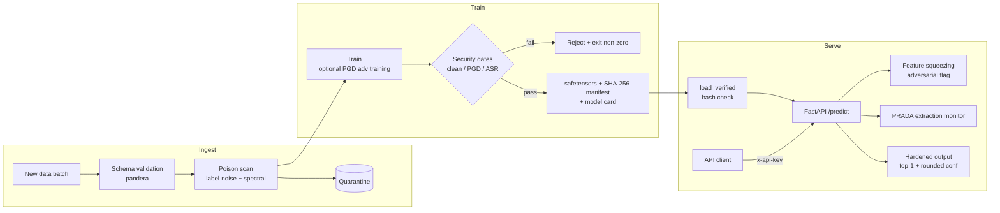

# Threat Model: Aegis-ML

This threat model covers the Aegis-ML classifier, its training/retraining
pipeline, and its inference API. Threats are mapped to the OWASP Machine
Learning Security Top 10 and the NIST AI 100-2 adversarial-ML taxonomy
(evasion, poisoning, privacy/extraction, abuse). Risk is a qualitative product
of likelihood and impact.

## Assets

| Asset | Why it matters |
| --- | --- |
| Training data integrity | Poisoned data creates backdoors or degrades accuracy. |
| Model weights (`*.safetensors`) | Tampered weights can run code on load or hide a backdoor. |
| Model confidentiality / IP | The trained function has value; querying can clone it. |
| Prediction integrity | Wrong predictions on manipulated inputs cause downstream harm. |
| API credentials | Leaked keys allow abuse and extraction. |
| Build / supply chain | A compromised action or dependency poisons every artifact. |

## Threat actors

| Actor | Capability | Goal |
| --- | --- | --- |
| External API client | Black-box queries with a valid or stolen key | Evade the model, steal it |
| Malicious data supplier | Contributes a batch to the retraining pipeline | Poison / backdoor the model |
| Supply-chain attacker | Can influence a GitHub Action or dependency | Inject code into builds |
| Insider | Can submit data or read artifacts | Exfiltrate IP, plant a backdoor |

## Attack surface

## Threats and controls

Likelihood (L) and Impact (I) are Low / Medium / High. Risk = L x I.

| # | Threat | OWASP ML | NIST AI 100-2 | L | I | Risk | Control | Where in code |
| --- | --- | --- | --- | --- | --- | --- | --- | --- |
| T1 | Adversarial examples (FGSM/PGD) flip predictions | ML01 Input Manipulation | Evasion | High | Med | High | PGD adversarial training; feature-squeezing detector flags perturbed inputs | `defenses/adversarial_training.py`, `defenses/input_detection.py`, `models.py` |
| T2 | Label-flip poisoning degrades accuracy | ML02 Data Poisoning | Poisoning (availability) | Med | Med | Med | Confident-learning label-noise detector quarantines mislabeled samples | `defenses/poison_detection.py` (`detect_label_noise`) |
| T3 | BadNets backdoor via trigger patch | ML10 Model Poisoning | Poisoning (integrity / backdoor) | Med | High | High | Spectral-signatures detector + ASR gate; poison quarantined before retrain | `attacks/poisoning.py`, `defenses/poison_detection.py` (`detect_backdoor_spectral`), `pipeline/secure_retrain.py` |
| T4 | Model extraction via inference queries | ML05 Model Theft | Privacy / extraction | High | Med | High | PRADA per-client query monitor; hardened output (no probability vector); rate limit | `defenses/extraction_detection.py`, `api/app.py` |
| T5 | Malicious model file executes code on load | ML06 AI Supply Chain | Supply chain | Low | High | Med | safetensors only (no pickle, CWE-502); SHA-256 manifest; `load_verified` refuses on mismatch | `artifacts.py` |
| T6 | Tampered or out-of-spec training batch | ML02 Data Poisoning | Poisoning | Med | Med | Med | pandera schema validation (range, type, NaN, duplicates) before training | `pipeline/secure_retrain.py` (`validate_schema`) |
| T7 | Output integrity / confident wrong answers leak signal | ML09 Output Integrity | Evasion / extraction | Med | Med | Med | Output hardening: top-1 label + 2-decimal confidence only | `api/app.py` |
| T8 | Unauthorized API access | ML05 Model Theft | Abuse | Med | Med | Med | API-key auth with `secrets.compare_digest`; keys from env; auth-failure metric | `api/app.py` |
| T9 | Compromised CI action or dependency | ML06 AI Supply Chain | Supply chain | Low | High | Med | SHA-pinned Actions, least-privilege `permissions`, Gitleaks, pip-audit, Trivy, Bandit SARIF | `.github/workflows/ci.yml` |

## MITRE ATLAS

The relevant ATLAS tactics are Reconnaissance and ML Model Access (T4, T8),
ML Attack Staging (T1, T3), Poison Training Data (T2, T3, T6), and Exfiltration
(T4). Specific technique IDs are intentionally omitted where not verified.

## Residual risk

- Robustness is measured only against L-infinity PGD at a fixed epsilon and a
  single BadNets trigger. Other attacks (C&W, patch, clean-label) are not
  covered.
- Feature squeezing detects roughly half of strong adversarial inputs at a 5%
  false-positive budget; it is a detector, not a guarantee.
- PRADA raises an alert after a client has already issued many queries, so some
  functionality leaks before the throttle triggers.
